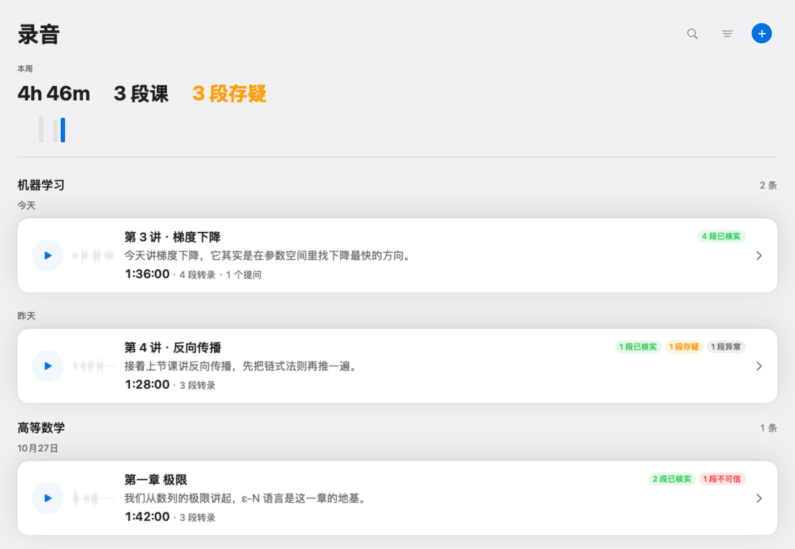
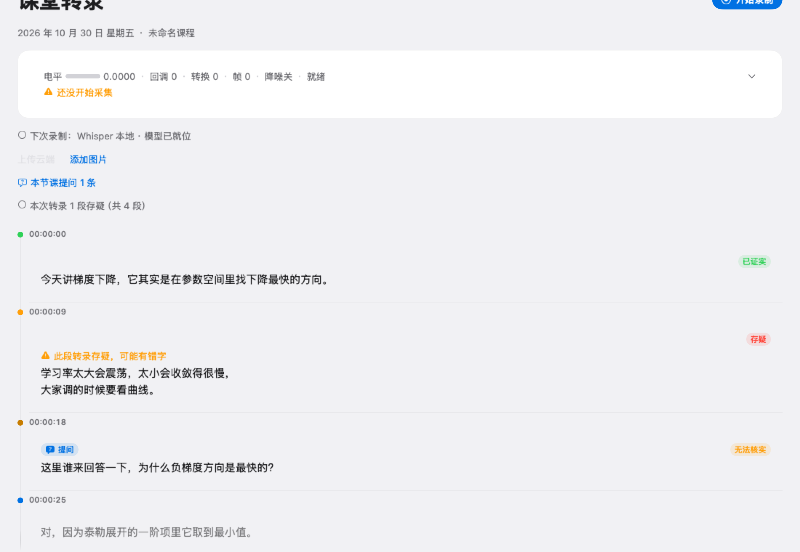

# Classroom Transcriber

把一节中文课录下来，**实时转成带标点的文字**，课后自动整理成学习笔记，并标出「哪一段可能听错了」「老师提了哪些问题」。

本地优先：音频、模型、转录结果都留在这台机器上；联网只在你主动点「核查 / 查答案 / 生成笔记」时发生。




## 它解决什么

课堂上你没法一边听一边记，记了也记不全；录音回去听一遍要花一节课的时间。这个 App 做三件事：

1. **实时转录**：10 秒一个窗口滚动出句，边上课边看到文字；
2. **不用重听**：整节课转成文本，带时间戳；存疑的段落单独标出来；
3. **课后可复习**：生成学习笔记、导出 Markdown、标出老师提过的问题。

## 关键设计（决定了它和「套个 Whisper 壳」的区别）

| 设计 | 为什么 |
|---|---|
| **静音窗不进模型**（VAD 门控） | 课堂里大段是翻页、写字、课间。实测长静音录音 38 窗跳过 28（73.7%），解码 CPU 从 114 秒降到 41.9 秒；静音也是「幻觉句」的主要来源，从源头掐掉 |
| **不压滑窗重叠** | 曾经把步长 3.0→9.6 秒（重叠 7→0.4 秒）试过：同一段真人录音 24 段/218 字 → 13 段/201 字，中间一整窗一个字都没出。**已量、已证有害，生产上前退回 3 秒** |
| **来源只能由代码拷贝** | 联网查证的链接一律从真实搜索结果里拷，模型只允许在正文里引用编号——结构上杜绝编造来源 |
| **无头快照自检**（`--ui-snapshot`） | 用 `ImageRenderer` 把界面渲成 PNG，不开 GUI 也能验「卡片是不是真从背景里分出来了」。离屏渲染救过一次「页头写着 3 条录音、列表区一张卡片都没有」的假完成 |
| **本地优先** | 模型、录音、转录都在本机；云端只做你主动触发的联网请求 |

## 功能状态

- ✅ 实时转录（Apple Speech 或 whisper.cpp 本地模型，可切换）
- ✅ 点句跳转音频、双击就地改错（人工改过的句子，重转不会覆盖）
- ✅ 课后重转（large-v3）+ 出处可查（哪一段来自哪个模型、哪个窗口）
- ✅ 静音门控（可关，设置页有开关；环境变量 `CLASSROOM_SPEECH_GATE` 可强制覆盖）
- ✅ 说话人分离（离线，FluidAudio helper 子进程，段级编号）
- ✅ 事实核查（逐段或自动，来源可点）
- ✅ 课后学习笔记 + Markdown / Obsidian 导出（术语页、课程索引一并生成）
- ✅ 转录导出：SRT / VTT / Markdown / JSON，带说话人和时间戳
- ✅ 老师提问 → 学生自主查答案（逐条或批量，答案必标来源）
- 🚧 Windows 版（见 `windows/`，目前是可验证的最小切片：重采样 + 滑窗 + 门控 + 合并）
- ❌ 云端同步 / 账号 / 移动端（不在路线图内）

## 构建（macOS 26+，无需完整 Xcode）

需要 Homebrew 的 `whisper.cpp` 和 Command Line Tools：

```bash
brew install whisper.cpp
./build.sh                      # 产物在 build/ClassroomTranscriber.app
open build/ClassroomTranscriber.app
```

模型不进仓库：首次启动会引导下载 `ggml-medium-q5_0.bin`（约 514 MB）到
`~/Library/Application Support/ClassroomTranscriber/models/`。

无头自检（不需要 GUI、不需要麦克风）：

```bash
BIN=build/ClassroomTranscriber.app/Contents/MacOS/ClassroomTranscriber
$BIN --selftest                  # 主自检（含提问、导出、编辑持久化）
$BIN --speech-gate-selftest      # 静音门控判据
$BIN --questions-selftest        # 提问数据层
$BIN --transcript-export-selftest # SRT/VTT/Markdown/JSON
$BIN --obsidian-selftest         # Obsidian 导出（临时目录）
$BIN --ui-snapshot /tmp/ui-snap  # 界面快照（渲 PNG，不开窗口）
```

## 目录

```
Sources/
  Transcription/   转录管线：取窗、门控、合并、幻觉过滤、说话人
  Services/        模型下载、联网服务（检索 / 核查 / 笔记）、配置
  Stores/          录音与设置的状态
  Views/           SwiftUI 界面
  Theme/           设计 token（颜色/字号/间距/卡片）
  Snapshot/        无头界面快照（自检用）
tools/probes/      可复跑的验证脚本（不做进 App）
windows/           Windows 版（最小切片，进行中）
```

详细分层见 [ARCHITECTURE.md](ARCHITECTURE.md)。

## 参与

见 [CONTRIBUTING.md](CONTRIBUTING.md)。**先说结论：这个项目对「静音误判」这件事很敏感**——
把真人小声说话判成静音，等于整段吞掉用户的课。任何改动碰到门控、切窗、增益，都必须带真实录音的前后对照。

## 许可

Apache License 2.0，见 [LICENSE](LICENSE)。
